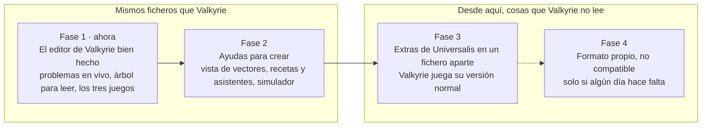

# Valkyrie Universalis: editor de escenarios

23 de octubre de 2026 · kozka

## La idea

El editor de escenarios de Valkyrie, rehecho para que crear sea fácil, para Mansiones, Descent y DooM, y escribiendo exactamente los mismos ficheros que el de Valkyrie.

- Lo que acaba en los ficheros se porta del C#: guardar, recargar, empaquetar, nombres y valores por defecto, renombrar, borrar, reordenar y probar. Las pantallas se diseñan de nuevo.
- Hasta que kozka diga que está listo, solo se ve en local (`iniciar.bat`): la versión de Vercel ni lo enseña ni lo lleva dentro.
- Es una parte más de la app: no cambia nada de lo que ya funciona.

## Reglas que no se negocian

Lo primero es que nadie edite un escenario y se le rompa: lo que guarda el editor tiene que abrir y jugarse igual en Valkyrie de escritorio.

1. **Nada se rompe.**
   - Tras guardar, el editor vuelve a leer lo escrito y lo compara con lo que tenía. Si no coincide, conserva la versión buena y avisa.
   - Siempre queda la versión anterior: un historial de guardados para volver atrás, también tras cerrar.
   - Solo escribe los `.ini` y los `Localization.*.txt`. Las imágenes, los sonidos y los demás ficheros de la carpeta no se tocan, y nada se borra sin confirmarlo.
   - Lo que cierra Valkyrie no se empaqueta sin decirlo bien claro.
2. **Los mismos ficheros que el editor de Valkyrie**: formato 21, las mismas claves, el mismo orden de componentes y los mismos finales de línea. Dentro de los `.ini`, nada que Valkyrie no conozca.
3. **Solo en local hasta que esté listo**: el botón del editor sale solo en desarrollo, y su código no entra en la versión construida. Desde el 12 de noviembre de 2026, a petición de kozka, unos días abierto a prueba en la app publicada: al entrar, un aviso grande («El editor no está listo. Estamos en fase muy temprana: úsalo solo para probarlo, no como herramienta final»), y solo se abre en un ordenador, no en el móvil ni en la tableta. `EDITOR_PREVIEW` en `packages/app/editorPreview.ts`: con `false`, vuelve a ser solo local, sin aviso.
4. **Una parte más**: carpetas propias (`packages/engine/src/QuestEditor/` y `packages/app/src/editor/`), cambios mínimos en lo que ya existe, y las pruebas, la batería y Playwright siguen en verde.

## Las cuatro fases



*Hasta la fase 2, el editor escribe exactamente lo que escribe Valkyrie. Ahora toca la fase 1; las demás, más adelante.*

Las fases 1 y 2 solo cambian la herramienta: los ficheros son los de Valkyrie. La 3 añade un fichero que Valkyrie no lee, y la 4 queda para si algún día hace falta.

## Lo que encontraron los validadores en la tienda

*Uno de cada diez escenarios publicados tiene algo que cierra o rompe Valkyrie.* Porcentaje de los 228 escenarios de la tienda con cada problema, según `validar.py` de las skills mansiones-valkyrie y descent-valkyrie, pasado el 23 de octubre de 2026:

| Problema | Mansiones (169) | Descent y DooM (59) |
| --- | ---: | ---: |
| **Algo que cierra o rompe Valkyrie** | **16 (9 %)** | **8 (14 %)** |
| Imágenes o sonidos que no están | 34 (20 %) | 14 (24 %) |
| Botones o `add=` a algo que no existe | 11 (7 %) | 13 (22 %) |
| Botones sin texto | 28 (17 %) | 10 (17 %) |
| Una UI que nunca se quita | 18 (11 %) | 0 |
| Sin final de victoria | 10 (6 %) | 0 |
| Sin final de derrota | 37 (22 %) | 2 (3 %) |
| Expansiones sin declarar | 81 (48 %) | 9 (15 %) |
| Eventos sueltos (no siempre un error) | 155 (92 %) | 49 (83 %) |

Uno de cada cinco tiene imágenes o sonidos que no salen. Los eventos sueltos no siempre son un error: muchos son pruebas o eventos que el autor llama aparte, así que el editor los lista aparte, sin alarmar, y deja marcarlos como hechos a propósito.

## Fase 1: el editor de Valkyrie, bien hecho

La fase 1 hace todo lo que hace el editor de Valkyrie, en los tres juegos, y además enseña los problemas en cuanto aparecen y el árbol de eventos para encontrar cualquier cosa.

*Todo en una pantalla, con los problemas debajo en cuanto aparecen* (boceto):

```text
┌──────────────────────────────────────────────────────────────────────────┐
│ Guardar · Deshacer · Rehacer · Probar · Crear paquete                    │
├──────────────────┬──────────────────────────────────┬────────────────────┤
│ Componentes      │ Mapa, visto desde arriba         │ Propiedades        │
│ por tipo, con    │ losetas, fichas, puertas y       │ lo que tengas      │
│ buscador         │ grupos; colocar, mover y girar   │ elegido; evento:   │
│ Ctrl+K: ir a     │ con rejilla; zonas y casillas    │ texto, botones,    │
│ cualquiera; un   │ al pasar el ratón                │ condiciones, qué   │
│ punto rojo o     │                                  │ añade y qué quita; │
│ naranja si tiene │                                  │ modo texto: su .ini│
│ problemas        │                                  │                    │
├──────────────────┴──────────────────────────────────┴────────────────────┤
│ Problemas · Árbol · Textos · Variables                                   │
│ problemas en vivo, con clic para ir al sitio · árbol desde el inicio o   │
│ desde cualquier evento · textos por idioma, con lo que falta · dónde se  │
│ escribe y se lee cada variable                                           │
└──────────────────────────────────────────────────────────────────────────┘
```

Se elige, se ve y se cambia en la misma pantalla, sin ir de lista en lista como en el editor de Valkyrie.

- **Mesa de trabajo**: componentes con buscador (Ctrl+K para saltar a cualquiera), mapa visto desde arriba con rejilla, propiedades a la derecha y, abajo, problemas, árbol, textos y variables. Deshacer y rehacer de todo (Valkyrie no tiene), guardado automático con historial y un modo texto con el `.ini` de cada componente, para quien hoy edita a mano.
- **Eventos**: cada uno se lee en una ficha, con vista previa del texto como sale en partida y paleta de símbolos; cada botón con su texto, su color, su destino y «crear evento nuevo aquí». Condiciones legibles («llave = 1 Y #heroes ≥ 3»), con aviso cuando se mezclan Y y O, que Valkyrie evalúa de izquierda a derecha. Y «dónde se usa» en cada componente.
- **Problemas**: las unas 300 comprobaciones de los validadores de las skills, en vivo y con sus tres niveles (rompe Valkyrie, no hará lo que esperas, sugerencia). Clic para ir al sitio, arreglos de un clic cuando son obvios y «ignorar este aviso» guardado fuera de los `.ini`.
- **Árbol de eventos, para leer y encontrar**: desde el inicio o desde cualquier evento, hacia abajo (qué dispara, con el texto de cada botón) y hacia arriba (quién lo llama), con condiciones, lo que añade y quita y los finales. Los sueltos aparte, sin alarmar, los bucles y el camino a la victoria. Y un panel de variables: dónde se escribe y se lee cada una.
- **Textos e idiomas**: tabla de claves por idioma con lo que falta, el idioma por defecto a la vista, el corrector del navegador y «leer la aventura como un libro», en el orden del árbol.
- **Probar**: «Guardar y probar» con el número de investigadores, como en Valkyrie, con un panel al lado: variables en vivo y editables, por qué saltó cada evento y «abrir este evento en el editor».
- **Ficheros**: la carpeta `Editor` de cada juego, en el navegador; nuevo, copiar uno descargado para estudiarlo, borrar, importar `.valkyrie`, zip o carpeta, exportar y crear paquete. En Chrome o Edge de escritorio, además, abrir la carpeta `Editor` de Valkyrie: las dos apps sobre los mismos ficheros (no a la vez), con aviso si algo cambió por fuera. Y antes de publicar, la lista de lo que miran el revisor y el robot de la tienda.
- **Descent y DooM**: MPlace, activaciones, casillas según el número de héroes, tienda, campañas, frags y portales, con las comprobaciones propias de cada uno.

| De las skills | En el editor | Fase |
| --- | --- | --- |
| `validar.py` | Panel de problemas en vivo | 1 |
| `grafo.py` | Árbol de eventos | 1 |
| `valkyrie_io` (renombrar, borrar, referencias) | «Dónde se usa», renombrar y borrar sin romper nada (ya portado en el motor) | 1 |
| `buscar.py` y el catálogo | Paletas de losetas, monstruos, objetos, sonidos y activaciones, con buscador en español | 1 |
| `empaquetar.py` | Crear paquete | 1 |
| `losetas.py`, `mapa.py` | Zonas al pasar el ratón (1); fichas sobre lo dibujado y piezas unidas salida con salida (2) | 1 y 2 |
| `nuevo_escenario.py`, `nueva_mision.py` | Asistente de escenario nuevo | 2 |
| `patrones.md`, `patrones-doom.md`, `doom.py` | Recetas que se insertan | 2 |
| `diseno-escenarios.md` | Consejos de diseño y bloqueos | 2 |

## Cómo se demuestra que no rompe nada

Cada paso se da por bueno solo si los escenarios publicados salen intactos y Valkyrie de escritorio abre lo que guarda el editor.

- **Ida y vuelta** con las 2.428 aventuras de la batería: abrir y guardar sin tocar nada deja los mismos componentes y textos. Las que guardó por última vez el editor de Valkyrie salen idénticas, salvo la línea `; Saved by version`.
- **Editar de verdad**: renombrar, borrar, añadir y reordenar en esos escenarios, y comprobar que siguen cargando, que el validador no empeora y que arrancan en la batería.
- **Los ejemplos de las skills** (*La casa del relojero*, *La campana de Vadoscuro* y *Fuga en Hesperia*), editados con el editor, validan sin avisos y se recorren enteros con el motor.
- **Uno nuevo hecho de cero** con el editor valida, se juega en Universalis, y kozka lo abre, lo juega y lo vuelve a guardar en Valkyrie de escritorio sin diferencias.
- **El orden de los componentes se conserva**: decide en qué orden saltan dos eventos con el mismo disparador.
- **Todo lo de antes sigue en verde**: pruebas, batería y Playwright.

## Pasos

Nueve pasos. El primero no tiene pantallas: es lo que escribe los ficheros y la prueba de que no estropea ninguno.

1. **E.1 Núcleo**: lo que falta portar del C# (guardar, recargar, empaquetar, nuevo, copiar y borrar, valores por defecto, reordenar), las operaciones del editor con deshacer y la batería de ida y vuelta.
2. **E.2 Validadores y árbol** en TypeScript, comparados con los de las skills en los 228 escenarios.
3. **E.3 Pantalla del editor**, solo en desarrollo: lista de escenarios, ficheros y paquetes.
4. **E.4 Mesa de trabajo y mapa.**
5. **E.5 Propiedades** de los componentes de Mansiones, con el evento como pieza central y el modo texto.
6. **E.6 Paneles** de problemas, árbol y variables.
7. **E.7 Textos e idiomas.**
8. **E.8 Probar** desde el editor.
9. **E.9 Descent y DooM.**

**Hito de la fase 1**: los 228 escenarios de la tienda se abren y se guardan sin cambiar nada; uno de cada juego, editado en Universalis, se abre sin problemas en Valkyrie de escritorio; y uno nuevo, hecho de cero en Universalis, se juega igual en las dos apps.

Lo que queda de la fase Mansiones (el jugador robot, comparar con la app de escritorio) espera, como pasó al adelantar Descent. El robot vuelve como simulador en la fase 2.

## Dónde vamos

A 24 de octubre de 2026, por la mañana: hechos los nueve pasos, de E.1 a E.9. El editor se ve solo en local (`iniciar.bat`): en el menú de cada juego, «Editar Escenario» («Editar Aventura» en Descent y DooM).

| Paso | Resultado |
| --- | --- |
| E.1 Núcleo | Las 2.428 aventuras de la batería se abren, se guardan y se vuelven a abrir sin cambiar nada de lo que carga Valkyrie (0 cambiadas, 0 errores; *Curse of Set* no se abre, como en el editor de Valkyrie). Editándolas de verdad (706 aventuras, 138.642 renombrados con deshacer y rehacer, 27.623 borrados, guardar y volver a abrir), ninguna se rompe. |
| E.2 Comprobaciones | Unas 240, de una aventura y de un paquete entero, en tres niveles: rompe Valkyrie, no hará lo que quería el autor, sugerencia. Frente a los validadores de las skills en los 228 escenarios de la tienda: 98 dan lo mismo y 13 difieren, todos explicados, casi siempre porque la nueva mira mejor. |
| E.3 Pantalla | La carpeta `Editor` con buscador: nuevo, copiar (también uno bajado), borrar preguntando antes, importar un `.valkyrie`, un zip o una carpeta, y exportar. Al abrir uno: sus ficheros, sus problemas, guardar, recargar y crear paquete. |
| E.4 Mesa de trabajo | Todo en una pantalla: componentes por tipo con buscador (Ctrl+K) y un punto en los que tienen problemas; el mapa visto desde arriba con rejilla, donde se elige, se arrastra ajustando como en Valkyrie y se gira (R); lo común de lo elegido (renombrar, posición, fichero, comentario, qué lleva a él y adónde lleva, sus problemas, borrar, volver a lo anterior); y abajo, los problemas en vivo y los ficheros. Deshacer y rehacer de todo; recargar, salir y cerrar la página preguntan si hay cambios sin guardar. Al guardar, primero una versión de los ficheros (las 20 últimas, para volver a cualquiera, también tras cerrar) y después se vuelve a leer lo escrito: si no sale igual, los ficheros quedan como estaban. Lo no guardado se apunta aparte y, si el editor se cerró sin guardar, se ofrece recuperarlo. |
| E.5 Propiedades | El modo texto: cualquier componente, y el propio escenario, como las líneas de su `.ini` y de sus textos, que se cambian escribiendo y se cargan como lo haría Valkyrie. Con eso ya se puede editar todo a mano desde el editor, mientras llegan las fichas de cada tipo. La ficha del evento, con todo lo de la de Valkyrie: diálogo, activador, sonido y música, selección de héroes en Descent, qué añade y qué quita, cuota, siguientes eventos en orden o al azar, botones (color, texto, a qué llevan y su condición) y pruebas y asignaciones de variables; las fichas, puertas, interfaces, generadores y puzles enseñan las partes del evento que enseña Valkyrie para ellos. Las fichas del escenario (nombre, oculto, portada, música, descripción, sinopsis, autores, expansiones, investigadores, duración y dificultad), de las losetas (lado o imagen propia), de los marcadores (tipo, tamaño, imagen, clic) y de las puertas (color y giro), con la ventana de Valkyrie para elegir lados, tipos e imágenes por expansión y atributos. Las de la interfaz (con una pantallita que enseña dónde cae), los generadores, los objetos de escenario, los puzles, las casillas de monstruo y los monstruos propios con sus activaciones. Encima de cada texto largo, la fila de símbolos de Valkyrie, que pone el código de cada uno donde está el cursor. Debajo del diálogo, la vista previa: como sale en la partida, con los nombres que cita, los símbolos dibujados y los botones con sus colores. Y en el mapa, como en Valkyrie, el componente elegido sólido y su sitio marcado con la diana: el ancla de una loseta, la casilla de monstruo o el sitio de un evento. |
| E.6 Paneles | Los problemas, dichos con palabras en español e inglés: qué pasa en Valkyrie y, cuando está claro, cómo se arregla, con el sitio donde están (pulsando se va al componente) y la clave que los tiene. Los de arreglo seguro, con su botón (una imagen escrita con `\`, un pack usado sin pedirlo, un escenario oculto); y los que no rompen Valkyrie se pueden dejar de avisar, guardado junto a las versiones. El árbol de eventos: desde el inicio, cada activador con sus eventos en el orden de Valkyrie, y debajo lo que lanzan sus botones (con su texto y su condición), lo que añaden y quitan, los cambios de aventura y lo que lanzan una derrota o una variable; los finales marcados, los bucles sin abrir otra vez, los sueltos aparte y sin alarmar, y la opción de dejar solo el camino a un final. Desde lo elegido, adónde lleva y qué lleva a él. Las variables: cada una con su clase, dónde se cambia, dónde se lee y qué textos la enseñan. |
| E.7 Textos e idiomas | La tabla de los textos por idioma: una fila por texto, por componente, y una columna por idioma, el de por defecto primero, con lo que le falta a cada uno; cada texto se escribe donde se pulsa, solo en ese idioma, con buscador, «solo lo que falta» y una columna para un idioma nuevo. Arriba, en qué idioma escriben las fichas (el de la app, como en Valkyrie, que ahora se cambia desde el editor) y el idioma por defecto, que se puede cambiar entre los que tienen textos; si el escenario no tiene textos en el tuyo, un aviso lo dice antes de escribir. Un campo cuyo texto falta en tu idioma dice de qué idioma es el que se ve. El corrector del navegador, en el idioma de cada texto. Y la aventura leída como un libro: todos los textos que lee un jugador, en el orden del árbol y como salen en la partida, cada botón llevando a su pasaje. |
| E.8 Probar | «Guardar y probar», como en Valkyrie: cuántos investigadores, y la partida con héroes al azar. Al lado, un panel con los eventos que han saltado y por qué (un activador, el botón tal de tal evento, una pieza pulsada en el tablero) y las variables en vivo, que se cambian y se añaden. Se vuelve al editor con el historial de deshacer desde el menú de la partida, desde el «Volver» de la elección de clases de Descent, desde el panel (a un evento) o al acabar la partida, donde Valkyrie se va al menú principal. La prueba carga también las expansiones que pide el escenario. |
| E.9 Descent y DooM | Las campañas: el editor de Valkyrie lista sus aventuras como escenarios sueltos; aquí salen debajo de su campaña, con «Nueva aventura» y, en la mesa de trabajo, una lista para pasar de una a otra. Una aventura se comprueba con la campaña entera, se empaqueta y se exporta con ella, y se prueba cambiando de aventura desde la carpeta de la campaña. El panel de la prueba sigue la partida por la campaña (los cambios de aventura y en qué aventura está cada evento, que abre esa aventura en el editor), y un botón puede llevar a otra aventura, elegida en su lista de siguientes eventos. DooM, desde su botón, con solo sus misiones, una nueva con su pack y la prueba con marines; las casillas para 1 héroe; la tienda en el árbol; y una comprobación nueva: un `Defeated<generador>` que no salta porque su grupo se junta con otro del mismo monstruo. |
| Mesa de trabajo, segunda vuelta | A petición de kozka, el 24 de octubre por la tarde: la ficha del componente, a la izquierda, como en Valkyrie, y la lista de componentes a la derecha. Los tres paneles (ficha, lista y el de abajo) se pliegan a una tira con su nombre y se ensanchan arrastrando el borde; cada dispositivo recuerda cómo se dejaron. Arriba, solo lo que se usa siempre, en grupos: volver, el menú «Archivo» (guardar, recargar, versiones, ficheros, crear paquete, exportar, volver a la lista, menú principal), deshacer y rehacer, «Guardar» (se ilumina si hay cambios), «Probar» y qué paneles se ven. Abajo, una línea de estado con lo que encuentran las comprobaciones (cada nivel lleva a los problemas), lo que se acaba de hacer y en qué idioma se escribe. El mapa, con su columna de herramientas: rejilla, ajuste a la rejilla, acercar, alejar, ver todas las piezas y girar la pieza elegida, que también gira Ctrl o Alt con la rueda; al abrir un escenario se ven todas sus piezas. La lista, con iconos por tipo, un + en cada tipo para crear, y un interruptor para dejar solo lo que tiene algo que arreglar. La ficha, por partes plegables con su número (diálogo, cuándo y dónde, botones, qué muestra y qué quita, pruebas, asignar, sonido, fichero y comentario), con las listas en cajas de altura mínima como las de Valkyrie, el diálogo alto, y renombrar en la cabecera. Teclas para todo (la ventana «Teclas», con ?). |
| Grafo, historial, selecciones y pantalla | A petición de kozka, el 26 de octubre, adelantado de la fase 2. El grafo, en la pestaña «Grafo» de abajo: una fila por evento que empieza un activador, marcadores redondos con su imagen, losetas cuadradas, eventos discontinuos con sus botones en un cuadrado en sus colores, condiciones en rosa (las de un botón, con el borde verde si lo muestra, rojo si lo apaga, amarillo si no cambia nada), + y − en lo que pone y quita, llaves en los botones que lanzan varios eventos y ① ② ③ en lo que sale varias veces. Se edita en él: crear y enlazar eventos desde los puertos de los botones, poner piezas nuevas o existentes, quitar enlaces, meter un evento en medio, crear y borrar desde el clic derecho, mover nodos; elegir un nodo lo elige en la ficha y en el mapa. Zoom, filtro por filas, buscador, leyenda y minimapa. En el panel derecho, el historial de cambios (volver a cualquiera) y las últimas selecciones. Y la pantalla: las interfaces como salen en la partida, para colocarlas arrastrando. |
| Mesa de trabajo, tercera vuelta | A petición de kozka, el 26 de octubre por la tarde. En el mapa, una ficha bajo una puerta se elige: los marcadores van antes que las puertas y estas antes que las losetas, y otro clic en lo elegido elige lo de debajo. La ficha de la izquierda, como la de Valkyrie: sin x e y (la pieza se mueve en el mapa; un evento o una casilla, con «Colocar en el mapa»), la imagen con su tipo al lado y la rotación y el tamaño en una línea; el diálogo y los textos largos se escriben viendo su formato (negrita, cursiva, color), con los símbolos solo en los textos de la partida y sin ellos en la descripción, la sinopsis y los autores; el cuadro crece con el texto hasta un límite. Sin vista previa en la ficha: un ojo enseña el diálogo como en la partida, sobre el mapa. Orden: diálogo, sonido, cuándo y dónde, qué pone y qué quita, botones, pruebas, asignar. El color de un botón, un cuadrito con su paleta; su condición, en una ventana como la de Valkyrie (pruebas, {Ninguno}, Desactivar, Ocultar, Cancelar y Ok), con el «?» del color de lo que hace. La pantalla de interfaces, en el orden en que las pone el evento. El panel derecho, nunca más estrecho de 260 px ni con barra horizontal. Cuatro juegos de colores para el editor (Crepúsculo, el de siempre; Grafito; Papel, claro; Alto contraste). En el grafo, lo que pone o quita un evento sale junto a él. |

Lo que el editor de Valkyrie rompe y el de Universalis no:

- Al renombrar, los textos que nombran el componente (`{c:…}`, `{qst:…}`) y los de los ataques de un monstruo propio le siguen.
- Un disparador `Defeated` de otro monstruo cuyo nombre empieza igual no cambia.
- Al borrar un evento, sale de todas las veces que lo nombra un botón (los azares con pesos).
- Un texto que al guardarse no se leería igual se escribe de la forma que sí, o no se guarda nada.
- Un escenario que no se puede abrir se enseña con sus problemas, en vez de cerrar la app.
- Recargar pregunta antes de tirar los cambios sin guardar.
- Guardar no pisa nada sin guardar antes una versión, y lo escrito se vuelve a leer: si no sale igual, los ficheros vuelven a como estaban.
- Lo que no se ha guardado no se pierde si el editor se cierra.
- Un paquete con algo que rompe Valkyrie se crea solo después de preguntar.
- Escribir en un idioma que el escenario no tiene avisa antes: en Valkyrie, lo escrito va callado a un idioma nuevo, y quien juega en el del escenario sigue leyendo lo de antes.
- Una prueba carga las expansiones que pide el escenario: la de Valkyrie solo carga las que eligió el jugador, y una loseta de otra la para. Y al acabar vuelve al editor, no al menú principal.
- Las imágenes propias de losetas y marcadores se escriben con barras normales, que valen en todos los sistemas: el editor de Valkyrie en Windows pone contrabarras, y el escenario solo las encuentra en Windows.
- Una interfaz con imagen puede volver a ser texto, un objeto puede quedarse sin evento al inspeccionarlo y el escenario sin portada: en Valkyrie, la opción «{Ninguno}» de esas ventanas nunca se ve.
- Las ventanas para elegir no dejan fuera el juego base: la de Valkyrie busca un pack llamado «base», y la de los monstruos de un generador se abre sin ninguno.
- La salud, el horror y la percepción que se escriben en un monstruo propio sin base se guardan: el editor de Valkyrie los pierde.
- Probar una aventura de una campaña cambia de aventura desde la carpeta de la campaña: la prueba de Valkyrie busca la siguiente dentro de la propia aventura y no la encuentra.
- Una aventura no se empaqueta suelta, que no se podría jugar: el paquete es el de su campaña.
- Las casillas para 1 héroe de un generador se ven y se cambian cuando el escenario admite uno (las misiones de DooM): el panel de Valkyrie solo enseña las de 2 a 4.

Las comprobaciones encuentran cosas que se les escapan a las skills: 15 textos con un `{qst:` sin cerrar, que paran Valkyrie (traducciones de *Eyes Behind the Mirror*, *Return to the Mirror* y *Mansión abandonada*), claves con parámetros que no existen y marcas partidas por un salto de línea. Y no dan por perdidos los sonidos que Valkyrie sí encuentra en las carpetas de idioma.

Siguiente: el hito de la fase 1, que necesita a kozka y Valkyrie de escritorio: abrir allí uno de cada juego editado en Universalis y uno hecho de cero, y jugarlo igual. Antes de enseñar el editor, sus textos en los otros 11 idiomas.

## Fase 2: ideas

La fase 2 escribe los mismos ficheros; solo añade ayudas para crear más deprisa y encontrar las cosas antes.

- **Vista de vectores que se edita**: eventos como cajas y flechas, con lo que lleva a qué. Se crean y se conectan eventos ahí mismo, el panel de la izquierda enseña el evento completo mientras te mueves, y salen apagados los que no cuelgan de ninguna ficha o nadie usa.
- **Historial**: una ventana a la derecha con los eventos vistos y editados, para volver a ellos en un clic.
- **Nombres automáticos**: las opciones de `EventCogerTaza` nacen como `EventCogerTaza_A` y `EventCogerTaza_B`, en vez de la numeración de Valkyrie, que avanza y rellena huecos.
- **Recetas** de las skills, con sus parámetros: Exploración, Búsqueda, personaje, tirada, temporizador, Mitos, puzle con premio y finales en Mansiones; puerta, grupo, jefe, tienda, ciudad y campaña en Descent; portal, mazo de amenaza, Argent, armas y frags en DooM.
- **Asistente de escenario nuevo**, con lo que hacen `nuevo_escenario.py` y `nueva_mision.py`.
- **Mapa asistido**: unir piezas salida con salida, poner una ficha «sobre la chimenea», casillas de grupos para 2, 3 y 4 héroes.
- **Simulador**: el jugador robot jugando cientos de partidas al azar; dice qué eventos no salen nunca, dónde se bloquea, qué finales se alcanzan y cuántas rondas dura.
- **Probar desde cualquier evento**, con las variables que elijas, y ver cómo está el tablero al llegar a él.
- **Consejos de diseño** de las skills: linealidad, fichas que no se quitan tras usarlas, llaves sin alternativa, bucles sin contador.
- **Notas, carpetas y colores del autor** en un fichero aparte, comparar versiones, traducciones en hoja de cálculo y «exportar para Claude» con el informe.

El historial y los nombres automáticos son baratos: si sobra tiempo, pueden adelantarse al final de la fase 1.

## Fases 3 y 4

La fase 3 añade cosas que solo ve Universalis sin que Valkyrie deje de jugar el escenario; la 4, un formato propio, queda para si algún día hace falta.

- **Cómo funciona la 3**: un `universalis.json` en la carpeta del escenario y una variable normal, `universalis`, que Universalis pone a 1 al empezar si ese fichero lo pide. En Valkyrie vale 0, así que el escenario se bifurca con condiciones normales de Valkyrie y cada app va por su camino. Ningún componente apunta a algo que Valkyrie no conozca, y el editor enseña y comprueba los dos caminos.
- **Ideas para la 3**, nada espectacular: los rompecabezas que Valkyrie no tiene (Líneas y Anillos), con un código como alternativa; límite de pasos en los puzles; puzles nuevos (diales, cables, secuencias); relámpago, temblor, niebla u oscuridad en una sala; retrato y nombre de quien habla; cartas y periódicos con aspecto de documento; narración por evento; un diario de pistas.
- **La 4**: casi todo lo que daría se consigue con la 3 y su alternativa, y un formato que solo abre Universalis parte en dos a autores y jugadores. Solo tendría sentido para algo que Valkyrie no puede representar, como otro juego. Hasta entonces, nada de JSON.

## Decisiones

Tomadas con kozka el 23 de octubre de 2026.

| Tema | Decisión |
| --- | --- |
| Juegos | Mansiones, Descent y DooM. Mansiones primero; Descent y DooM, en el último paso de la fase 1 |
| Aparatos | Ordenador y tabletas grandes. En el móvil, abrir, ver los problemas y probar |
| Formato | El de Valkyrie hasta la fase 4, sin JSON: cambia la decisión de «escenarios nuevos en JSON» del plan general |
| Árbol y grafo | Árbol para leer y encontrar en la fase 1; la vista de vectores que se edita, el historial y los nombres automáticos, en la 2 |
| Visibilidad | Solo en local hasta que kozka diga que está listo |
| Eventos sueltos | No son un error: lista aparte, sin alarmar, y se pueden marcar como hechos a propósito |
| Seguridad | Comprobar después de guardar, la versión anterior siempre a mano y nada se borra sin confirmar |
