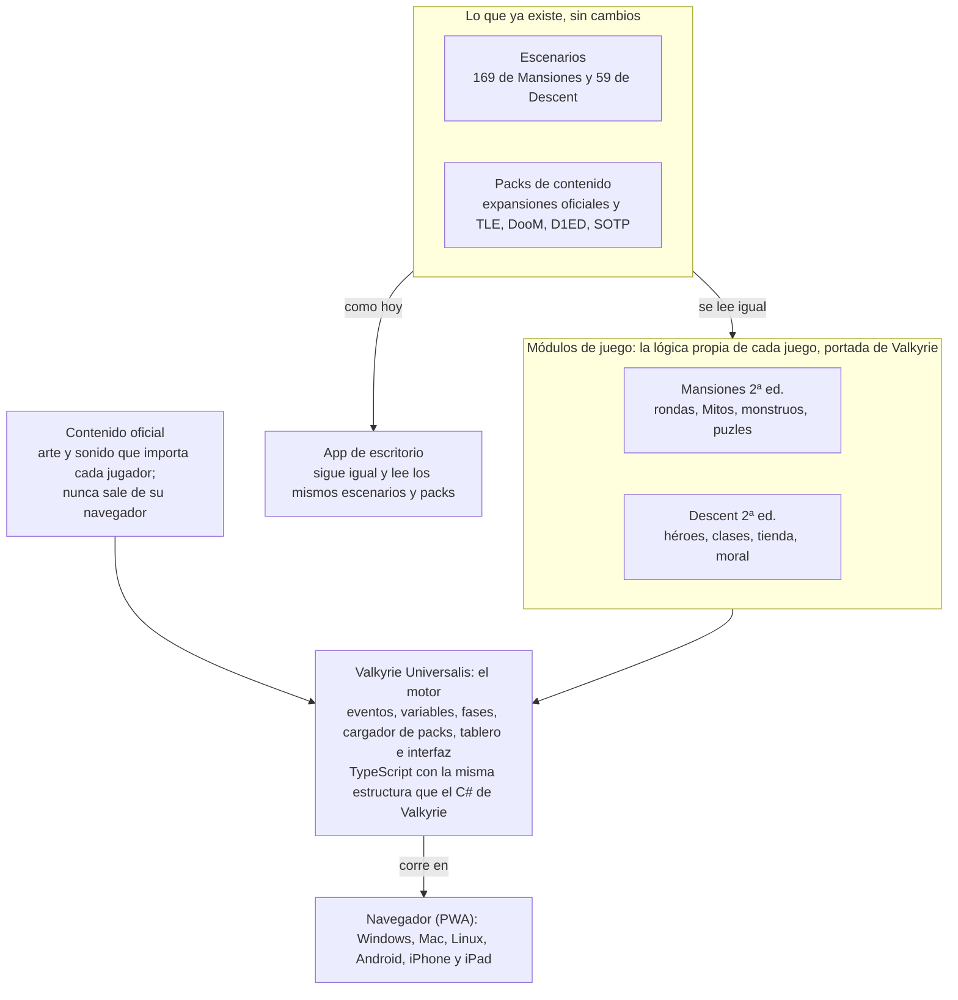
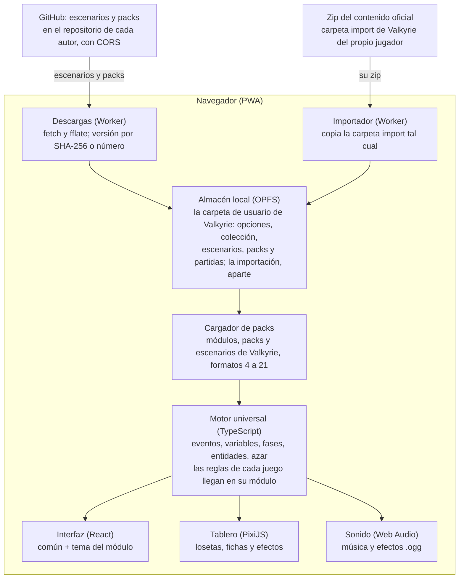

# Valkyrie Universalis: plan

7 de octubre de 2026 · kozka

Valkyrie Universalis es un motor de juego universal que corre en el navegador. Mansiones de la Locura y Descent 2ª edición son sus dos primeros módulos, cada uno con la lógica propia de su juego, y todo lo que ya existe se usa tal cual: los escenarios, los packs de contenido (expansiones oficiales y de la comunidad, como Doom) y los repositorios de la tienda de Valkyrie. Las dos apps conviven: la de escritorio sigue funcionando igual mientras la web crece.

## La idea



*Lo que ya existe no cambia: Universalis lo lee como Valkyrie. Un motor común debajo y la lógica de cada juego en su módulo.*

Los escenarios y los packs de contenido se leen igual que en Valkyrie y desde los mismos repositorios. Cada pack dice si es de Mansiones o de Descent, y lo carga ese módulo. Para arreglar algo de Mansiones se toca su módulo; para mejorar la app, el motor.

## Principios

Son los tuyos, con lo que implica cada uno:

- **Un motor y un módulo por juego.** El motor no sabe de ningún juego en concreto; lo propio de Mansiones y de Descent va en su módulo.
- **Convivir con la app actual.** Mismas listas, mismos repositorios y misma forma de actualizar; nada de lo que ya existe se toca, y las dos apps funcionan a la vez.
- **Compatibilidad total.** Los escenarios de Mansiones y Descent (formatos 4 a 21, paquetes `.valkyrie`) y los packs de contenido (`.valkyrieContentPack`), oficiales y de la comunidad, se abren sin cambios. Si algo se comporta distinto, el fallo es nuestro.
- **Fácil de seguir para quien mantiene Valkyrie.** El código nuevo copia la estructura del de Valkyrie, para que Quantumrunner pueda leerlo y arreglarlo sin aprender otro mundo.
- **Contenido oficial aparte.** Ni la app ni los módulos traen o alojan imágenes, sonidos o textos de la editorial. Cada jugador importa los suyos y se quedan en su navegador.
- **Cada cosa se actualiza por su lado.** El motor, cada módulo, cada pack y cada escenario tienen su propia versión.
- **Primero todo lo de Valkyrie, luego los extras.** Mansiones y Descent se juegan como en Valkyrie, con un aspecto nuevo. Los extras de la versión web esperan a que funcione todo lo que tiene Valkyrie, editor incluido.
- **Sin servidor.** Todo es estático (PWA): se instala desde el navegador en cualquier sistema y juega sin conexión lo ya descargado.
- **Código abierto derivado de Valkyrie (Apache-2.0).** Se conservan su LICENSE y su NOTICE.

## Convivir con Valkyrie

Todo lo que existe hoy se usa sin tocarlo: Universalis solo lee. Para lo nuevo, dos reglas: va en ficheros que Valkyrie ni lee ni reescribe, y nada de lo que Valkyrie conoce apunta a ello.

| Pieza | Dónde está hoy | Qué hace Universalis |
| --- | --- | --- |
| Lista de escenarios | [valkyrie-store](https://github.com/NPBruce/valkyrie-store): `MoM/manifestDownload.ini` (169) y `D2E/manifestDownload.ini` (59) | La lee igual y descarga cada `.valkyrie` del repositorio de su autor |
| Lista de packs de contenido | valkyrie-store: `contentPacksManifestDownload.ini` de Mansiones (TLE) y de Descent (DooM, D1ED, SOTP) | La lee igual y descarga cada `.valkyrieContentPack` |
| Expansiones oficiales | Valkyrie: `content/MoM` y `content/D2E`, packs con su `content_pack.ini` | Las carga con el mismo cargador que Valkyrie |
| Packs de la comunidad | Repositorios de sus autores, como el de [Doom](https://github.com/Neuntoter82/Doom_2016_Mod); solo datos en el formato de Valkyrie | Mismo cargador; su `type` (`MoMCustom` o `D2ECustom`) dice qué módulo los usa |
| Escenarios del proyecto | valkyrie-questdata (activo; último cambio en febrero de 2026) | Como cualquier otro escenario |
| Packs antiguos | valkyrie-contentpacks (marcado como obsoleto; parado desde 2016) | Se ignora |
| App de escritorio | [valkyrie](https://github.com/NPBruce/valkyrie) 3.28; Quantumrunner sigue arreglando errores | Referencia de comportamiento; cada versión nueva se revisa y se porta |

Lo que importa de cada pieza:

- **Los packs de la comunidad ya se usan**: 11 de los 59 escenarios de Descent necesitan DooM y 4 de los 169 de Mansiones necesitan TLE. Son solo datos en el mismo formato que las expansiones oficiales ([wiki](https://github.com/NPBruce/valkyrie/wiki/Create-Custom-Content-Packs)), así que el cargador de Valkyrie portado los abre tal cual.
- **Valkyrie ignora lo que no conoce**: en un escenario se salta los tipos de componente que no conoce («If not known ignore», en `QuestData.cs`), y de un pack solo lee los ficheros que lista su `content_pack.ini`. Pero su editor, al guardar o empaquetar, reescribe los .ini solo con lo que conoce, y lo demás desaparece sin aviso. Por eso lo que solo entiende Universalis va en un fichero aparte dentro de la carpeta del escenario o del pack. Valkyrie no lo lee ni lo borra, y al empaquetar mete la carpeta entera en el .valkyrie. La otra regla: ningún componente que Valkyrie conozca puede apuntar a uno nuevo, porque un `add=` a un nombre que no existe la cierra.
- **Nada se escribe en la tienda**: mismas listas, mismos repositorios y misma forma de actualizar (el SHA-256 de cada escenario y el `version` de cada pack). Un autor publica como ahora y su trabajo sale en las dos apps.
- **Los datos base salen del propio repositorio de Valkyrie**: `content/MoM` y `content/D2E` se copian dentro de la app desde una versión concreta de Valkyrie, salvo las imágenes: entre ellas hay arte de la editorial (losetas escaneadas de la 1ª edición y retratos de héroes), así que se descargan de su repositorio la primera vez y quedan en caché. Los datos cargan así al instante y sin conexión; un script los renueva cuando sale otra versión, y un arreglo de Quantumrunner en esos datos llega también a Universalis.
- **Pensado para que Quantumrunner lo entienda**: el TypeScript copia la estructura del C# fichero a fichero (`QuestData.ts`, `EventManager.ts`, `VarManager.ts`…), con los mismos nombres, comentarios y tests. Un arreglo en un lado se localiza y se replica en el otro sin buscar. Se descarta compartir el C# compilado a WebAssembly, que obligaría a separar la lógica de Unity dentro de Valkyrie.
- **Escenarios nuevos en el formato de Valkyrie**: uno guardado solo en JSON no abriría en la app de escritorio, así que el editor escribe exactamente lo que escribe el de Valkyrie, y lo que solo entienda Universalis va en un fichero aparte (decisión del 23 de octubre de 2026; un formato propio queda para una posible fase 4 del editor, `docs/plan-editor.md`).

## Qué va en el motor y qué en cada módulo

El motor sabe hacer cosas de juego de mesa en general; cada módulo le dice cómo es un juego en concreto. La regla para decidir: si Mansiones y Descent lo necesitan igual, va al motor.

| Tema | Motor universal | Módulo de cada juego | En Mansiones |
| --- | --- | --- | --- |
| Escenarios y eventos | Disparadores, condiciones, operaciones, botones, añadir y quitar del tablero (la semántica de Valkyrie) | Tipos de componente propios y sus campos | CustomMonster, Activation, Mitos |
| Turnos | Máquina de rondas y fases | Qué fases hay y qué pasa en cada una | Investigadores, Mitos, monstruos, Horror |
| Enemigos | Activar, elegir activación, vida y estados | Estadísticas, activaciones y su lógica | Alerta, Horror y Fuerza de cada monstruo |
| Packs de contenido | Cargador del formato de Valkyrie (`content_pack.ini`) | Qué tipos de pack acepta (`MoM*` o `D2E*`) | Expansiones oficiales y TLE |
| Mapa | Tablero, losetas, fichas, zonas, cámara | Tipos de loseta y de ficha | 174 caras de loseta con 435 zonas |
| Interfaz | Diálogos, menús y paneles accesibles y traducibles | Tema (fuentes, colores, marcos), paneles propios, iconos | Botón de fin de fase, iconos de atributos |
| Textos | Idiomas y marcado de texto | Textos propios y claves de los oficiales | Claves `{ffg:…}` del juego importado |
| Minijuegos | Marco común | Los minijuegos del juego | Puzles deslizante, de código, de imagen y de torre |
| Contenido oficial | Importador genérico (zip, imágenes, audio) | Receta: qué fichero es cada cosa | Carpeta `import` de Valkyrie |
| Partidas | Guardado, deshacer y azar con semilla | Datos de campaña | Variables que pasan de una parte a otra |
| Herramientas | El editor de Valkyrie, portado, y un validador | Comprobaciones propias | Las de nuestro `validar.py` |

## El módulo de un juego

Un módulo lleva la lógica propia de su juego, portada de Valkyrie, y lo que necesita para leer sus escenarios y packs. Los datos de juego (losetas, monstruos, objetos, Mitos) siguen en packs de contenido con el formato de Valkyrie, oficiales o de la comunidad; el arte oficial lo pone cada jugador al importar.

```text
universalis-mom                paquete del monorepo (packages/module-mom), con su propia versión
├── manifest.json              id, versión, motor que necesita, tipos de pack (MoM*)
├── schema/                    tipos de componente y sus campos (JSON Schema)
├── src/                       la lógica de Mansiones en TypeScript, con los nombres del C#:
│                              RoundControllerMoM.ts, MonsterDialogMoM.ts, HorrorCheck.ts…
├── ui/                        tema, paneles, plantillas de diálogo, iconos propios
├── i18n/                      textos propios por idioma
├── import/                    receta para importar el contenido oficial
└── tests/                     tests portados de Valkyrie y escenarios de referencia

packs de contenido             content/MoM de Valkyrie (oficiales) y los de la comunidad, sin cambios
contenido del jugador          arte, sonido y textos oficiales de su copia (privado)
```

- **Actualizaciones separadas**: si hay que arreglar una regla de Mansiones, se publica una versión nueva de su módulo y el motor no cambia. Si mejora el motor, los módulos siguen valiendo.
- **Versiones**: el módulo declara con qué versiones del motor funciona (por ejemplo, `>=1.2 <2`) y qué formatos de escenario de Valkyrie entiende (4 a 21 hoy).
- **Packs con lógica propia, más adelante**: un pack de la comunidad puede seguir siendo solo datos, o llevar además una carpeta con lógica en TypeScript que solo lee Universalis. Valkyrie no la ve, porque solo carga los ficheros que lista el `content_pack.ini`.
- **Mansiones y Descent comparten mucho**: lo común sube al motor y cada módulo guarda sus particularidades, como hace Valkyrie, que comprueba el tipo de juego en 77 sitios de su código.

## Objetos universales

Ninguna de las cuatro apps sabe dónde están las figuras: todas hacen de director de juego, dicen qué hacen los enemigos y llevan el estado de la partida ([Descent 3](https://www.boardgamequest.com/descent-legends-of-the-dark-review/), [Imperial Assault](https://geekdad.com/2018/01/star-wars-imperial-assault-legends-alliance-app-makes-original-game-better-ever/)). Eso cabe en un mismo motor; de un juego a otro cambian las piezas de esta tabla.

| Necesidad | Mansiones 2ª | Descent 2ª | Imperial Assault | Descent 3 | Juegos sin app |
| --- | --- | --- | --- | --- | --- |
| Eventos, condiciones y variables | Sí | Sí | Sí | Sí | Sí |
| Rondas y fases propias | Sí | Sí | Sí, activaciones alternas | Sí | Sí |
| Enemigos que dirige la app | Sí | Sí | Sí | Sí | Según el juego |
| Saber dónde están las figuras | No | No | No | No | Opcional |
| Campaña entre partidas | Con variables | Sí | Sí | Sí | Según el juego |
| Tienda, botín o fabricación | No | Tienda | Sí | Botín y fabricación | Según el juego |
| Minijuegos | Puzles | No | No | No | Según el juego |
| Mapa en 3D | No | No | No | Sí | Opcional |

Imperial Assault y Descent 3 quedan fuera, porque ya tienen sus apps; están en la tabla solo para comprobar que el diseño no les cierra la puerta.

Los objetos universales del motor salen de esa tabla:

- **Entidad con tipo**: cualquier cosa del juego; el módulo define sus campos.
- **Lugar**: loseta, zona, espacio y puerta, con su geometría.
- **Pieza**: ficha, figura o enemigo, con su imagen.
- **Carta y mazo**: robar, barajar, descartar; sirve para Mitos, objetos o encuentros.
- **Variable y contador**: números con nombre, de partida o de campaña.
- **Héroe**: personaje con su hoja, sus objetos y su progreso.
- **Fase y ronda**: la estructura del turno, definida por el módulo.
- **Evento**: disparador, condición, efectos y botones, como en Valkyrie.
- **Panel y diálogo**: lo que se ve en pantalla, con el tema del módulo.
- **Minijuego**: puzles y otras pruebas con su propia pantalla.
- **Campaña**: lo que pasa de una partida a la siguiente.
- **Tablero y cámara**: cómo se dibuja todo.

Si algún juego necesita seguir las figuras (enemigos que se mueven solos, línea de visión, caminos), se añade como módulo opcional con rejilla cuadrada o hexagonal, sin tocar lo demás.

## El tablero y las animaciones

Sin el 3D como prioridad, el tablero va con PixiJS: es el que mejor hace lo que importa ahora, un tablero en 2D bonito y animado. Los menús y diálogos van en React con animaciones de Motion.

- **PixiJS 8.22** para losetas, fichas y efectos: filtros de brillo, desenfoque o distorsión para el horror (pixi-filters 6.1), partículas para fuego y niebla, y animaciones Spine para monstruos y personajes (spine-pixi-v8 4.3).
- **@pixi/react 8** une el tablero con la interfaz en React.
- **En perspectiva, como un tablero sobre una mesa**, igual que en Valkyrie y en las apps oficiales. La cámara es la de Valkyrie: rueda o pellizco para el zoom, y arrastrar o flechas para moverse. Por defecto va más inclinada, 30° en vez de sus 10°, que apenas se notan, y en Opciones se pueden elegir los de Valkyrie; el centro de la pantalla enseña lo mismo que en Valkyrie. Cada pieza es un cuadrilátero de PixiJS que un shader propio proyecta en perspectiva, sobre el tapete que el jugador elige en Opciones (negro, verde, granate o azul), que es solo el del tablero en partida.
- **El 3D sigue siendo posible sin pagarlo**: las posiciones guardan también la altura (z = 0) y el tablero se dibuja a través de una interfaz propia. Un día se podría añadir un dibujador 3D sin tocar el motor ni los módulos.

Three.js solo compensaría si hubiera un juego en 3D, y ahora no lo hay.

## Aspecto de cada juego

Cada juego tendrá su aspecto, y más adelante también cada pack o escenario que lo pida, como DooM. Eso incluye colores de ventanas, botones y mesa, la fuente de los títulos (Valkyrie ya la cambia por juego con `GetHeaderFont`), iconos propios, marcos dibujados y efectos. Se pule en una fase posterior, pero los cimientos están puestos desde la demo para no tener que rehacer la interfaz:

- **Un solo sitio para el aspecto**: `theme.css` define papeles como tapete, panel, tarjeta, texto, acento, alerta, el papel y la tinta del tablero esquemático y las marcas de cada juego. Ningún componente tiene colores propios, y un test lo comprueba. El tablero esquemático y el tapete toman de ahí los colores y la fuente.
- **Ventanas oscuras, como las de Valkyrie**: las suyas son negras al 90 %, con el texto blanco y centrado, y los autores eligen los colores de sus textos para ese fondo. Por eso las tarjetas de lectura son oscuras, y la descripción y los eventos van centrados; un tema claro tendría que contar con ello.
- **Tapete y tema**: el tapete es solo el del tablero en partida, un papel (`--table`) que `<html data-felt>` cambia desde Opciones; negro por defecto. El fondo de la app va aparte (`--background`), y de momento `<html data-theme>` le da uno de cuatro colores desde la opción «Tema». Es provisional: kozka diseñará los temas completos en una app aparte, y Universalis los importará enteros.
- **Botones del inicio dibujados**: cada juego en el marco que dibujó kozka, con su imagen dentro y sus efectos, en un lienzo de PixiJS bajo botones HTML normales (`screens/gameArt.ts`); sin WebGL, una versión quieta en CSS. Es la primera pieza con imágenes y efectos, y la pauta para las demás.
- **Un aspecto por juego**: la app marca `<html data-game="MoM">` o `"D2E"`. El aspecto de un juego es un bloque `:root[data-game='D2E'] { … }` que cambia esos papeles.
- **Piezas compartidas**: todas las ventanas llevan el marco `.panel`, las tarjetas de lectura `.card` y los botones `.button`, con variantes como `.button.hud` sobre el tablero. Un marco hecho con imágenes, esquinas incluidas, se pone después con `border-image` en esas clases, sin tocar los componentes.

Lo que queda para esa fase:

- **Marcos e iconos con imágenes**, propias o de la importación de cada jugador; nunca imágenes de FFG en el repositorio.
- **Iconos por juego y por pack**: los símbolos de los textos (`ui/Symbols.tsx`) van por juego. Un pack o escenario puede traer los suyos en su `universalis.json`, y también pedir un aspecto propio encima del de su juego.
- **Efectos**: ventanas que aparecen y se cierran con Motion (las de la partida pasan todas por `WindowStack`), y efectos de PixiJS en botones y en el tablero.

## Módulos y packs hechos con IA

Más adelante, con un buen kit, una IA podrá montar un pack o un módulo nuevo en horas: lee las reglas, rellena el esquema, escribe la lógica y la prueba. El motor tiene que ponérselo fácil:

1. **Esquemas públicos y documentados** de cada objeto universal, con los módulos de Mansiones y Descent como ejemplo.
2. **Validador** que explica cada error en términos de juego, como nuestro `validar.py`.
3. **Simulador** de partidas automáticas que encuentra cuelgues, eventos inalcanzables y finales imposibles.
4. **Una skill para Claude** con todo el kit, como la de Mansiones, para crear y revisar packs y módulos.
5. **Prueba en mesa**: la última palabra la tienen las personas que juegan.

Tres reglas para que sea seguro:

- **Mecánicas con palabras propias**: ni un pack ni un módulo copian el texto de un reglamento ni traen arte o textos de la editorial; eso llega con la importación de cada jugador.
- **Código aislado**: la lógica que traiga un pack o un escenario es de terceros, así que se ejecuta en una caja cerrada. QuickJS compilado a WebAssembly (quickjs-emscripten 0.32) pone límite de memoria y de tiempo y deja el código sin red, sin ficheros y sin pantalla: solo habla con el motor. Tabletop Simulator hace algo parecido con [scripts en Lua](https://api.tabletopsimulator.com/).
- **Mismo resultado siempre**: con la misma semilla, los mismos packs y los mismos botones, la partida acaba igual. Eso permite guardar, deshacer, comparar con Valkyrie y reproducir errores.

Hay precedentes de motor universal con módulos por juego, como [VASSAL](https://vassalengine.org/about.html), con miles de juegos convertidos, y Tabletop Simulator; ninguno hace de director de juego como las apps oficiales.

## Valoración

Es más trabajo que portar Valkyrie tal cual, pero menos de lo que parece: Valkyrie ya separa casi todo lo común. De sus casi 41.000 líneas de C#, solo unas 1.340 son exclusivas de Mansiones y 1.450 de Descent. El código común comprueba en 77 sitios a qué juego se está jugando, y en una veintena más usa su nombre para buscar datos. Esos sitios son justo los huecos que rellenará cada módulo.

| Parte de Valkyrie | Líneas de C# | A dónde va |
| --- | --- | --- |
| Motor de juego: escenario, eventos, variables, rondas, monstruos, puzles, guardado | 9.569 | Motor universal; las reglas propias de cada juego, a su módulo |
| Contenido, packs, idiomas y tienda | 4.856 | Motor: el mismo cargador de packs, idiomas y tienda |
| Interfaz de partida, menús y widgets | 13.487 | Rehacer: interfaz común en HTML y paneles propios en cada módulo |
| Editor de escenarios | 10.032 | El de Valkyrie, portado, con sus pantallas rehechas |
| Plataforma, ficheros y arranque | 2.928 | APIs del navegador |
| Librerías: importador de la app oficial y utilidades | \~49.900 | Receta de importación de cada módulo; fuera de la demo |
| Pruebas unitarias (893 casos) | 14.231 | Vitest, repartidas entre motor y módulos |

Lo difícil:

- **La frontera entre motor y módulo.** Si el motor es rígido, Descent o un pack como DooM no caben; si es demasiado abierto, cada módulo acaba siendo un programa entero. Regla: cada objeto universal nace de un caso real (Mansiones) y se generaliza con el segundo (Descent), no antes.
- **Igualar a Valkyrie al detalle**, ahora repartido entre el motor y dos módulos: eventos en pila (el último que entra se ejecuta primero), eventos desactivados que se comprueban al encolar y al ejecutar, botón de continuar automático, cuotas y `$end`.
- **Seguir el ritmo de Valkyrie**: cada versión nueva de la app de escritorio puede cambiar algo, y hay que portarlo. La estructura espejo y los tests compartidos lo hacen barato.
- **Las variables son decimales de 32 bits**, las condiciones AND/OR se evalúan de izquierda a derecha sin precedencia y `#rand` se vuelve a tirar dentro de una condición.
- **Formatos de escenario 4 a 21** con sus conversiones, y los lectores de `.ini` y de localización con sus manías (comentarios, comillas `|||`, finales de línea mezclados).
- **El texto**: etiquetas de Unity (`<b>`, `<color>`, `<size>`), iconos que viven en la fuente de FFG y diálogos cuyo tamaño depende de la fuente.
- **El contenido oficial y la memoria de los iPhone** (secciones Librerías y Contenido oficial).

## Dentro del navegador



*Todo corre en el navegador, sin servidor propio. GitHub da los escenarios; el jugador aporta el contenido oficial.*

El tablero y el sonido leen del almacén las imágenes y el audio, y cada botón pulsado vuelve al motor. El motor no sabe nada de ningún juego: lo aprende del módulo que carga.

## Librerías y rendimiento

PixiJS para el tablero, la interfaz en HTML con React, el sonido directamente con Web Audio y la lógica de terceros aislada en QuickJS. Versiones de npm a 7 de octubre de 2026.

| Capa | Elección | Por qué | Descartado |
| --- | --- | --- | --- |
| Tablero | PixiJS 8.22, con pixi-filters 6.1, spine-pixi-v8 4.3 y @pixi/react 8 | Lo mejor para 2D bonito: filtros, partículas, animaciones Spine, mipmaps y texturas comprimidas | Three.js 0.186 (solo si un día hay un juego en 3D), Babylon.js 9.29 (más pesado), Phaser 4 (motor completo), Canvas 2D (sin mipmaps: las losetas parpadean al alejar) |
| Interfaz | React 19.3 y Zustand 5, en HTML encima del tablero | Diálogos con mucho texto, accesibles y traducibles; el tema de cada módulo con variables CSS | Svelte 5 (igual de válido y más ligero) |
| Lógica de terceros | QuickJS en WebAssembly (quickjs-emscripten 0.32) | Aislada, con límites de memoria y tiempo y resultados reproducibles | Lua con wasmoon 1.16, como Tabletop Simulator; SES 2.3 (JavaScript endurecido, sin límites de memoria ni tiempo) |
| Esquemas | JSON Schema validado con Ajv 8.20 | Para los ficheros propios de Universalis (`universalis.json`) y, si algún día llega, un formato propio de escenarios | Zod 4.6 (solo para TypeScript) |
| Sonido | Web Audio API con una capa propia; decodificador WASM de Ogg Vorbis (\~70 KB) solo en Safari anterior a 18.4 | Fundidos y volumen por canal; en iOS el volumen de `<audio>` no se puede cambiar | [Howler.js](https://www.npmjs.com/package/howler) (última versión de 2023), Tone.js (es para síntesis) |
| Almacenamiento | OPFS con la carpeta de usuario de Valkyrie tal cual (`config.ini`, `Download` con su `manifest.ini`, partidas) y la importación oficial aparte; los escenarios y las partidas se leen al usarlos; `navigator.storage.persist()` al importar y con la app instalada; copia de seguridad en un zip | Ficheros grandes sin cargarlos enteros en memoria, y los mismos ficheros y formatos que Valkyrie | localStorage (5 MB), IndexedDB con Dexie (no hace falta una base de datos: son ficheros), Cache Storage para contenido del usuario |
| Zip | fflate 0.8.3 para `.valkyrie`, `.valkyrieContentPack`, partidas y copias de seguridad; un lector propio con `DecompressionStream` para los zips grandes (la importación oficial, una copia de seguridad) | fflate es diminuto y rápido; el lector propio lee por trozos y no necesita tener 1–2 GB en memoria | JSZip (más lento, todo en memoria), [zip.js](https://github.com/gildas-lormeau/zip.js) 2.23 (no hizo falta) |
| Build y PWA | Vite 8.3, TypeScript y un service worker propio de unas 40 líneas, con la lista de ficheros que escribe Vite al construir | Instalable y sin conexión; solo se precachea la app, y una versión nueva espera a que el jugador recargue | vite-plugin-pwa 2.0 (Workbox 7.4): 338 paquetes (Babel, Rollup, Terser) para precachear una cuarentena de ficheros |
| Animación | Motion (MIT) y CSS en la interfaz; filtros y Spine en el tablero; [GSAP](https://gsap.com/standard-license) 3.15 si hace falta | GSAP es gratis desde la 3.13, también para uso comercial | — |
| Pruebas | Vitest y Playwright | Portar los 893 casos de test de Valkyrie y probar en Chrome, Safari y Android | — |

Rendimiento en móviles:

- **Memoria de texturas.** Una loseta de 4096×4096 ocupa 64 MiB en la GPU, y con mipmaps un 30 % más: 30 losetas así son unos 2,5 GiB y cierran un iPhone. A 1024×1024 son unos 160 MiB. Por eso, al importar, un Worker genera versiones de 2048, 1024 y 256 px y se carga la que pidan el zoom y el aparato.
- **Límite de iOS sin documentar.** Hay pestañas cerradas con unos 100 MB de memoria JavaScript en un iPhone SE y 200 MB en un iPad básico ([lapcatsoftware](https://lapcatsoftware.com/articles/2026/1/7.html)). Hay que medir en un iPhone de 3–4 GB desde la demo.
- **Texturas en Android.** Una cuarta parte de los móviles Android no pasan de 4096 px por textura ([web3dsurvey](https://web3dsurvey.com/webgl2/parameters/MAX_TEXTURE_SIZE)).
- **Efectos con medida**: filtros y partículas cuestan GPU; se limitan en móviles modestos y se desactivan si baja de 30 imágenes por segundo.
- **Decodificar fuera del hilo principal** (`createImageBitmap` en un Worker) y liberar lo que sale de la vista. Si se pierde el contexto WebGL, se reconstruye desde OPFS.
- **Sonido**: la música se reproduce en streaming (decodificada ocupa unos 21 MB por minuto) y los efectos van en memoria. Safari reproduce Ogg Vorbis desde la 18.4 (iOS 18.4 y macOS 15.4, [WebKit](https://webkit.org/blog/16574/webkit-features-in-safari-18-4/)); antes hace falta el decodificador WASM.

## Compatibilidad con las aventuras actuales

La compatibilidad se demuestra con pruebas: los tests de Valkyrie portados, los 169 escenarios de Mansiones y los 59 de Descent abriendo sin error con todos los packs que piden (oficiales, TLE, DooM, D1ED y SOTP), y partidas automáticas comparadas con la app de escritorio.

1. **Portar desde el código de Valkyrie 3.28** con la misma estructura de ficheros, no reescribirlo de memoria. El motor universal toma tal cual su semántica de eventos y variables (mismo orden de eventos, decimales de 32 bits con `Math.fround`); las rondas, monstruos y puzles de Mansiones van a su módulo, y lo de Descent al suyo.
2. **Portar sus pruebas unitarias** (24 ficheros, 893 casos) a Vitest con los mismos nombres. Tienen que pasar todas antes del hito 2.
3. **Batería de escenarios y packs**: los 169 de Mansiones y los 59 de Descent con sus packs, y los del editor de los autores que quieran colaborar, se cargan sin errores, con todas las aventuras de cada paquete: las campañas llevan varios quest.ini. Nuestro `validar.py` sirve de segunda opinión.
4. **Partidas automáticas**: un jugador robot pulsa botones con una semilla fija durante decenas de rondas en cada escenario. Ningún cuelgue, ninguna excepción.
5. **Comparar con Valkyrie**: en unos cuantos escenarios se graba en la app de escritorio una secuencia de botones y se comprueba que la web acaba en el mismo estado (variables, fichas en el tablero, eventos vistos). Valkyrie usa azar sin semilla, así que se comparan tramos sin azar o con el azar fijado.
6. **Cada versión nueva de Valkyrie**: se pasa la batería contra ella y se portan sus cambios, con una lista pública de diferencias pendientes.
7. **Partidas guardadas**: formato propio para empezar. Leer los `.vSave` de escritorio (un zip con `save.ini` y rutas absolutas) queda como opción.

Un detalle a respetar: en Android, Valkyrie dibuja las imágenes propias de los escenarios al doble de tamaño, porque usa 512 en vez de 1024 píxeles por cada 3,5 unidades. En la web, las imágenes propias deben usar siempre la escala de escritorio, que es como las ven sus autores, y las losetas oficiales la de la resolución con que se importaron.

## Contenido oficial

Cada módulo trae la receta para importar el contenido oficial de su juego: qué ficheros busca, cómo convierte imágenes, sonidos y textos y dónde los deja. El importador del motor es genérico, y lo importado lo usan los packs a través de sus rutas `{import}`, como en Valkyrie. Sin la importación, el juego se abre para mirar (menús, escenarios, detalles y colección), y la importación se pide al ir a jugar: al empezar un escenario, antes de elegir investigadores o héroes, o al continuar una partida; después se vuelve a ese escenario (`screens/ImportGate.tsx`, 6 de noviembre de 2026; del 10 de octubre hasta entonces, como en Valkyrie, el botón salía en gris). Para Mansiones:

- **Qué guarda Valkyrie al importar** (carpeta `MoM/import`): `img/*.dds` (DXT1, DXT5 o sin comprimir), `*.pvr` (ETC2, de Android), `*.tex` (comprimidas con crunch, que Valkyrie no usa), `audio/*.ogg`, `text/*.txt` (los textos `{ffg:…}`), `fonts/*.ttf` e `import.ini`. No convierte nada a PNG.
- **Importar en la demo**: el jugador elige la carpeta `import` que creó Valkyrie al importar desde su propia copia de la app oficial, o un zip de ella en el móvil (el mismo contenido que la importación por zip de Valkyrie). Nunca se enlazan ni se alojan zips de terceros. Un Worker copia los ficheros tal cual en OPFS, leyendo el zip por trozos. Las imágenes DDS, o PVR si se importó en Android (ETC2), se decodifican al usarlas, en otro Worker (con las filas al revés, como las guarda Unity), y se reducen a lo que aguanta el aparato: 2048 píxeles en el ordenador y 1024 en el móvil. Así importar es solo copiar, y no hace falta guardar varios tamaños.
- **Referencias**: los packs de contenido de Mansiones en Valkyrie hacen unas 880 referencias a imágenes importadas y 164 a audios (`{import}/img/Nombre`); se resuelven contra ese almacén probando extensiones en el mismo orden que Valkyrie.
- **Packs de Valkyrie**: los `.ini` de losetas, monstruos, objetos y Mitos (`content/MoM`, con los .txt: 0,5 MB) son Apache-2.0 y se incluyen. Sus 113 imágenes (17,9 MB) no: algunas son arte de la editorial, como losetas escaneadas de expansiones de 1ª edición y retratos. Se descargan del repositorio de Valkyrie, en el commit fijado, la primera vez que hacen falta, y quedan en caché.
- **Fuentes**: MAD Garamond Pro, que lleva los iconos de dados y atributos, no se puede redistribuir. Se carga desde la importación, con Old Newspaper Types para los títulos como en Valkyrie, y, sin ella, se usa una Garamond libre (EB Garamond, OFL) con iconos propios.
- **Modo esquemático, solo para pruebas**: losetas dibujadas con su contorno, zonas y objetos (`contenido_losetas.json` de nuestra skill, MIT), monstruos con siluetas genéricas y nombres del catálogo. Hasta el 10 de octubre de 2026 servía para jugar sin importar; desde entonces solo lo usan las pruebas automáticas y el desarrollo, que no pueden llevar contenido de la editorial.
- **Más adelante, importar desde la app oficial** (Steam) en el propio navegador. Hay librerías MIT de 2026 que leen paquetes de Unity ([unityfs-js](https://github.com/bainiao404/unityfs-js), [texture2ddecoder-wasm](https://github.com/fatal10110/texture2ddecoder-wasm)), pero todavía sin rodaje; lo seguro es portar el importador de Valkyrie. En iPad no se podrá: los datos de la app no son accesibles, así que se importa en el ordenador y se pasa el zip.

Para Descent, lo que guarda Valkyrie al importar desde la app Road to Legend (carpeta `D2E/import`, con FFG 1.5.2 o posterior) es lo mismo, sin fuentes: Valkyrie usa las suyas (Windlass para los títulos, una Garamond para el texto y `Descent_symbol` para los símbolos). Una importación hecha en Android (FFG 1.5.5) tiene 892 ficheros y 300 MB: 784 imágenes PVR (ETC2), 19 DDS, 73 OGG y 14 textos. Sus losetas son de 1024 o 512 píxeles, y Valkyrie las dibuja a 105 píxeles por casilla en todas las plataformas.

## Escenarios y tienda

No hace falta servidor: GitHub sirve las listas, los escenarios y los packs con CORS abierto, así que el navegador los descarga directamente del repositorio de cada autor, igual que Valkyrie. Los módulos de juego son paquetes del repositorio de Universalis, cada uno con su propia versión.

- **Las listas**: en valkyrie-store, `manifestDownload.ini` (escenarios) y `contentPacksManifestDownload.ini` (packs), una de cada para Mansiones y para Descent. Un proceso automático las regenera cada hora y añade a los escenarios valoración, partidas, duración y porcentaje de victorias. raw.githubusercontent.com responde con `access-control-allow-origin: *` (comprobado el 6 de octubre).
- **Los ficheros**: `url` + `<Id>.valkyrie` para escenarios y `url` + `<Id>.valkyrieContentPack` para packs, los dos zip. En raw.githubusercontent.com están 168 de los 169 escenarios de Mansiones, los 59 de Descent y los cuatro packs. En Mansiones, la mediana pesa 6 MB, el 90 % menos de 50 MB y el mayor 102 MB, y el catálogo entero, unos 2,8 GB. Los cuatro packs de la comunidad pesan de 1,2 a 89 MB.
- **Peticiones simples**: GET sin cabeceras propias. raw.githubusercontent.com rechaza con 403 las comprobaciones previas (OPTIONS) que dispara cualquier cabecera añadida.
- **El escenario de GitLab**: su ruta `/-/raw/` no envía CORS ([incidencia abierta](https://gitlab.com/gitlab-org/gitlab/-/issues/16732)); se usa la API de ficheros de GitLab, que sí lo envía, o se deja fuera de la demo.
- **Actualizaciones**: en un escenario, `version` es el SHA-256 que calculó el editor de Valkyrie al empaquetar y que la tienda copia del .ini de su autor; en un pack, un número que sube su autor. La fecha `latest_update` es solo informativa. Valkyrie guarda la versión que daba la lista al descargar y ofrece actualizar cuando la lista trae otra. No recalcula el hash, que en 2 de los 59 escenarios de Descent no coincide con el fichero.
- **Caché y licencias**: lo descargado se guarda en OPFS. Se descarga bajo demanda y nunca se replica: 106 de los 118 repositorios de escenarios de Mansiones revisados no tienen licencia.
- **Límites de GitHub**: no publica los de raw, y los endureció en mayo de 2025 ([GitHub](https://github.blog/changelog/2025-05-08-updated-rate-limits-for-unauthenticated-requests/)). Al descargar cada jugador desde su conexión, la carga se reparte.
- **Sin proxy en Vercel**: su política de uso prohíbe hacer de proxy ([AUP](https://vercel.com/legal/acceptable-use-policy), abril de 2026), y el plan gratuito solo incluye 10 GB al mes de tráfico de origen.
- **Estadísticas**: Valkyrie las descarga de Google Drive, que no permite CORS; para la demo bastan los campos de la lista. Enviar victorias y derrotas se deja para después.

## Demo en Vercel

La demo vale si un escenario de Mansiones de la tienda se juega de principio a fin en Chrome de escritorio, Safari de iPhone y Chrome de Android con la app instalada, y si otro que necesita el pack TLE se abre igual que en Valkyrie.

Alcance:

1. **Motor mínimo**: entidades, eventos, variables, fases, cargador de packs, tablero en PixiJS e interfaz base.
2. **Módulo de Mansiones mínimo** con el lector de escenarios de Valkyrie: prólogo, eventos y diálogos con botones, variables y condiciones, losetas y fichas, Exploración, Búsqueda, Mitos, monstruos básicos, final y el paso de una aventura a otra dentro del paquete, que los cuatro escenarios con TLE usan nada más empezar.
3. **Listas de la tienda** (escenarios y packs), con portada, duración, dificultad y valoración; descarga y caché.
4. **Un pack de la comunidad**: TLE, descargado de su repositorio y cargado como en Valkyrie.
5. **Importar el contenido oficial**: del zip al arte real de losetas y monstruos; sin él, modo esquemático.
6. **PWA**: instalable, sin conexión y con guardado automático.

Fuera de la demo: el editor, las estadísticas, las partidas guardadas compatibles con escritorio y Descent. Los cuatro puzles de Mansiones sí entran, porque los escenarios de TLE los usan.

Escenario del hito: *Exotic Material* (de la tienda, sin expansiones, 285 KB). *La Casa del Relojero*, el ejemplo de nuestra skill, sirve solo para pruebas locales. Para TLE, Desert\_en o Snow\_en: piden siete expansiones más TLE y cambian de aventura nada más pasar su introducción.

Publicación: kozka sube el proyecto a GitHub con GitHub Desktop, y Vercel lo compila con Vite desde ese repositorio (con su fichero `vercel.json`), solo estático y sin funciones (9 de octubre de 2026). Así se prueba en el móvil por HTTPS, que hace falta para que el móvil registre el service worker y la app funcione sin conexión. Hasta que esté madura, no se anuncia. El plan gratuito (Hobby) incluye 100 GB de transferencia al mes y es solo para uso personal no comercial ([Vercel](https://vercel.com/docs/plans/hobby)), lo que encaja con un proyecto de fans sin anuncios ni donaciones.

## Fases

```mermaid
flowchart LR
  f1["Demo<br/>hecha, 7–10 oct. 2026<br/>motor mínimo, un escenario, pack TLE"]
  f2["Descent 2ª<br/>1–2 meses<br/>segundo módulo, 59 escenarios, DooM, D1ED, SOTP"]
  f3["Mansiones<br/>2–3 meses<br/>todo MoM portado, 893 casos de test, 169 escenarios"]
  f4["Editor<br/>empezado el 23 oct. 2026<br/>el de Valkyrie bien hecho, en sus ficheros, para los tres juegos"]
  f5["Después<br/>cuando toque<br/>packs con lógica, 3D si hace falta, otros juegos"]
  f1 -- "Hito 1: escenario completo en 3 navegadores" --> f2
  f2 -- "Hito 2: Descent y sus packs sin rehacer el motor" --> f3
  f3 -- "Hito 3: tests y 169 escenarios sin fallos" --> f4
  f4 -- "Hito 4: un escenario nuevo juega en las dos apps" --> f5
```



*La Demo probó el motor con Mansiones; Descent demuestra que es universal. Estimación a ojo: una persona con Claude Code a media jornada.*

Cada fase empieza al cumplir el hito anterior. Lo universal añade trabajo al principio: la demo necesitaba 6–8 semanas, frente a las 4–6 de un port directo, y se hizo en cuatro días porque el port fichero a fichero trajo de golpe casi todo el motor. Las duraciones son a ojo y se recalculan con lo que cueste de verdad cada fase.

Descent va antes que el resto de Mansiones desde el 10 de octubre de 2026, a petición de kozka. El hito de la Demo se cumplió ese día en Chrome de escritorio y en Android con la app instalada; Safari de iPhone queda pendiente hasta tener uno a mano. El motor ya carga las 295 aventuras de Descent y arranca sin fallos las 59 de la tienda, así que lo que falta es sobre todo la app.

Su hito: *Affairs of Wizards* se juega de principio a fin con la importación oficial; un escenario con tienda se juega comprando y vendiendo; *The Shadow Rune* pasa de una aventura a la siguiente; y uno que pide DooM se abre igual que en Valkyrie. Lo que queda de Mansiones (jugador robot, comparar con la app de escritorio, las pantallas que faltan y el aspecto definitivo) viene después.

El editor empezó el 23 de octubre de 2026, también antes de lo que queda de Mansiones, a petición de kozka. Tiene su propio plan, en cuatro fases (`docs/plan-editor.md`): la primera es el editor de Valkyrie bien hecho, para Mansiones, Descent y DooM, que escribe los mismos ficheros y solo se ve en desarrollo hasta que kozka diga que está listo (desde el 12 de noviembre de 2026, unos días abierto a prueba en la app publicada, con un aviso al entrar y solo en ordenador: `packages/app/editorPreview.ts`).

## Riesgos y decisiones abiertas

El riesgo mayor no es técnico: las normas de FFG para fans no permiten su propiedad intelectual en aplicaciones, y Valkyrie existe porque lo toleran. El segundo es diseñar de más y no acabar nunca.

| Riesgo | Qué pasaría | Cómo se cubre |
| --- | --- | --- |
| Normas de FFG: «no podemos permitir nuestra propiedad intelectual en aplicaciones de software de ningún tipo» ([política](https://images-cdn.fantasyflightgames.com/filer_public/fa/b1/fab15a15-94a6-404c-ab86-6a3b0e77a7a0/ip_policy_031419_final_v21.pdf)) | Aviso o retirada | Igual que Valkyrie: sin dinero de ningún tipo (tampoco donaciones), etiquetada «no oficial, hecha por fans», sin logos ni marcas de FFG en el nombre y sin alojar nunca su contenido |
| Romper la app de escritorio | Escenarios o packs que dejan de funcionar en Valkyrie | Universalis solo lee lo que existe; lo nuevo va donde Valkyrie lo ignora, y nada de lo que Valkyrie conoce apunta a ello |
| Quedarse atrás respecto a Valkyrie | Escenarios nuevos que fallan en la web | Estructura espejo del C#, tests compartidos y batería contra cada versión nueva |
| Diseñar de más | Un motor universal que no juega a nada | Cada objeto universal nace de Mansiones y se generaliza con Descent |
| Lógica de terceros en packs y escenarios | Un pack con errores o malicioso bloquea la app o curiosea | QuickJS aislado, con límites de memoria y tiempo, sin red ni ficheros |
| El motor no se comporta como Valkyrie | Escenarios que fallan o cambian | Port fiel, 893 casos de test, 228 paquetes con todas sus aventuras, los 4 packs de la comunidad y partidas automáticas |
| Memoria en iPhone | La pestaña se recarga a mitad de partida | Tamaños de textura por aparato desde la demo y pruebas en un iPhone real |
| Borrado de datos en Safari | Se pierde lo importado si no se usa en 7 días fuera de la app instalada ([WebKit](https://webkit.org/blog/14403/updates-to-storage-policy/)) | En iPhone y iPad, la app pide instalarla en la pantalla de inicio antes de importar (la app instalada guarda aparte y el navegador la respeta más); la copia de seguridad de Opciones; que reimportar se pueda reanudar |
| Ogg en Safari antiguo | Sin sonido antes de iOS 18.4 | Decodificador WASM que solo se descarga si hace falta |
| Licencias | Problemas al publicar | Apache-2.0 del código portado (LICENSE, NOTICE y ficheros marcados), MIT de librerías y datos, nada GPL (por ejemplo, AssetRipper) |

Decisiones:

- [x] Nombre: «Valkyrie Universalis» de momento; se puede cambiar
- [x] Lenguaje: TypeScript
- [x] Lógica de juego: portada a TypeScript calcando el C#, sin C# compilado a WebAssembly
- [x] Escenarios nuevos: en el formato de Valkyrie, sin JSON; un formato propio queda para una posible fase 4 del editor (23 de octubre de 2026; antes era JSON con esquema)
- [x] Interfaz: React
- [x] Tablero: PixiJS
- [x] Alcance: Mansiones, Descent y sus packs (incluido DooM); ni Imperial Assault ni Descent 3
- [x] Prioridad: primero todo lo que tiene Valkyrie; los extras de la web, después
- [x] Datos base: los .ini y textos, dentro de la app, copiados de una versión concreta de Valkyrie y renovados con un script; sus imágenes se descargan de su repositorio la primera vez, porque entre ellas hay arte de la editorial
- [x] Partidas: formato propio que guarde y cargue bien; abrir las de escritorio solo si sale fácil
- [x] Licencia: Apache-2.0, la misma que Valkyrie
- [x] Repositorio: GitHub, con el usuario de kozka, que lo sube con GitHub Desktop (antes era al terminar la Demo)
- [x] Probar en el móvil: Vercel, conectado a ese repositorio, da la dirección HTTPS
- [x] Orden de fases: Descent antes que el resto de Mansiones (10 de octubre de 2026)
- [x] Contenido oficial: hay que importarlo para jugar, en los dos juegos, como en Valkyrie; el modo esquemático queda para las pruebas (10 de octubre de 2026)
- [x] DooM: un botón propio en el inicio, debajo del de Descent, que juega Descent con el pack DooM y solo sus 11 misiones; la lista de Descent ya no las muestra (11 de octubre de 2026)
- [x] Móvil en vertical: las partidas, en horizontal como en Valkyrie (la pantalla gira sola en Android, instalada o a pantalla completa; si no, se pide girar el móvil, con la opción de seguir en vertical); los menús, como se sostenga el móvil (11 de octubre de 2026)
- [x] Temas: Universalis, el predeterminado, con dibujos detrás de las pantallas y, más adelante, marcos, botones e iconos de cada juego; colores lisos; y, por hacer, «Valkyrie clásico». Tapete negro puro e inclinación de Valkyrie por defecto (11 de octubre de 2026; `docs/temas.md`)
- [x] Editor: el de Valkyrie bien hecho, para Mansiones, Descent y DooM, escribiendo los mismos ficheros; solo en desarrollo hasta que esté listo (23 de octubre de 2026; `docs/plan-editor.md`), salvo unos días abierto a prueba en la app publicada, con un aviso al entrar y solo en ordenador (12 de noviembre de 2026)
- [ ] Contárselo a Quantumrunner cuando haya algo que enseñar, y ver si el código podría vivir junto al de Valkyrie

## Fuentes

- [Valkyrie](https://github.com/NPBruce/valkyrie): código de la versión 3.28 (junio de 2026), licencia Apache-2.0; cifras de líneas, tests, ramas por juego y carga de packs (`ContentData.cs`, `QuestData.cs`) contadas y leídas en ese código
- [Valkyrie wiki: packs de contenido personalizados](https://github.com/NPBruce/valkyrie/wiki/Create-Custom-Content-Packs)
- [valkyrie-store](https://github.com/NPBruce/valkyrie-store): listas de escenarios y de packs; packs que pide cada escenario y tamaños medidos sobre ellas
- [Pack DooM](https://github.com/Neuntoter82/Doom_2016_Mod), [TLE](https://github.com/xehnlp/TLE), [D1ED](https://github.com/Neuntoter82/D1ED) y [SOTP](https://github.com/afellowspelunker/SOTP): contenido de los cuatro packs de la comunidad
- [valkyrie-questdata](https://github.com/NPBruce/valkyrie-questdata) y [valkyrie-contentpacks](https://github.com/NPBruce/valkyrie-contentpacks) (este último, marcado como obsoleto)
- [Descent: Legends of the Dark, reseña de Board Game Quest](https://www.boardgamequest.com/descent-legends-of-the-dark-review/) y [Legends of the Alliance, reseña de GeekDad](https://geekdad.com/2018/01/star-wars-imperial-assault-legends-alliance-app-makes-original-game-better-ever/)
- [VASSAL](https://vassalengine.org/about.html) y [la API de scripts de Tabletop Simulator](https://api.tabletopsimulator.com/)
- [quickjs-emscripten](https://www.npmjs.com/package/quickjs-emscripten), [pixi-filters](https://www.npmjs.com/package/pixi-filters) y [spine-pixi-v8](https://www.npmjs.com/package/@esotericsoftware/spine-pixi-v8)
- [PixiJS: consejos de rendimiento](https://pixijs.com/8.x/guides/concepts/performance-tips)
- [WebKit: novedades de Safari 18.4](https://webkit.org/blog/16574/webkit-features-in-safari-18-4/) y [política de almacenamiento](https://webkit.org/blog/14403/updates-to-storage-policy/)
- [MDN: cuotas de almacenamiento y borrado](https://developer.mozilla.org/en-US/docs/Web/API/Storage_API/Storage_quotas_and_eviction_criteria)
- [web3dsurvey: tamaño máximo de textura en WebGL2](https://web3dsurvey.com/webgl2/parameters/MAX_TEXTURE_SIZE)
- [lapcatsoftware: memoria de Safari en iOS](https://lapcatsoftware.com/articles/2026/1/7.html)
- [Howler.js](https://www.npmjs.com/package/howler) y [@wasm-audio-decoders/ogg-vorbis](https://www.npmjs.com/package/@wasm-audio-decoders/ogg-vorbis) en npm
- [zip.js](https://github.com/gildas-lormeau/zip.js) y [fflate](https://github.com/101arrowz/fflate)
- [GSAP: licencia](https://gsap.com/standard-license)
- [Vercel: plan Hobby](https://vercel.com/docs/plans/hobby) y [política de uso](https://vercel.com/legal/acceptable-use-policy)
- [GitHub: límites para peticiones sin autenticar](https://github.blog/changelog/2025-05-08-updated-rate-limits-for-unauthenticated-requests/)
- [GitLab: CORS en ficheros raw](https://gitlab.com/gitlab-org/gitlab/-/issues/16732)
- [FFG: normas para el uso de su propiedad intelectual por la comunidad](https://images-cdn.fantasyflightgames.com/filer_public/fa/b1/fab15a15-94a6-404c-ab86-6a3b0e77a7a0/ip_policy_031419_final_v21.pdf)
- [Licencia Apache 2.0](https://www.apache.org/licenses/LICENSE-2.0)
- [unityfs-js](https://github.com/bainiao404/unityfs-js) y [texture2ddecoder-wasm](https://github.com/fatal10110/texture2ddecoder-wasm)
- [ValkyrieMCP](https://github.com/thijs-hakkenberg/ValkyrieMCP): datos de zonas de losetas (MIT)
- Versiones de librerías: registro de npm, consultado el 7 de octubre de 2026
